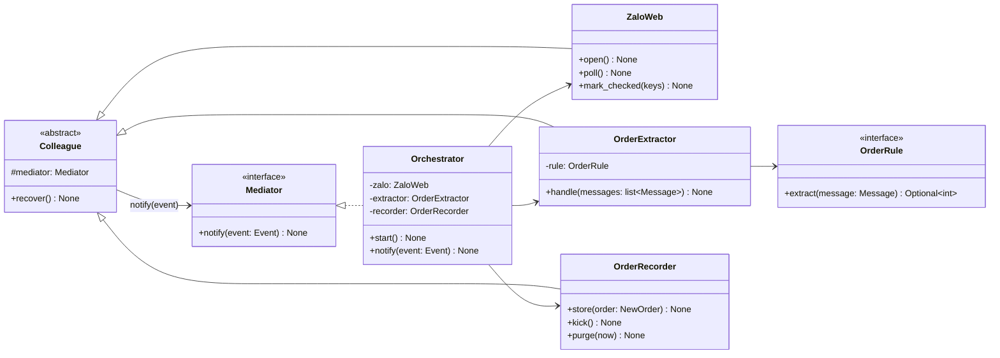
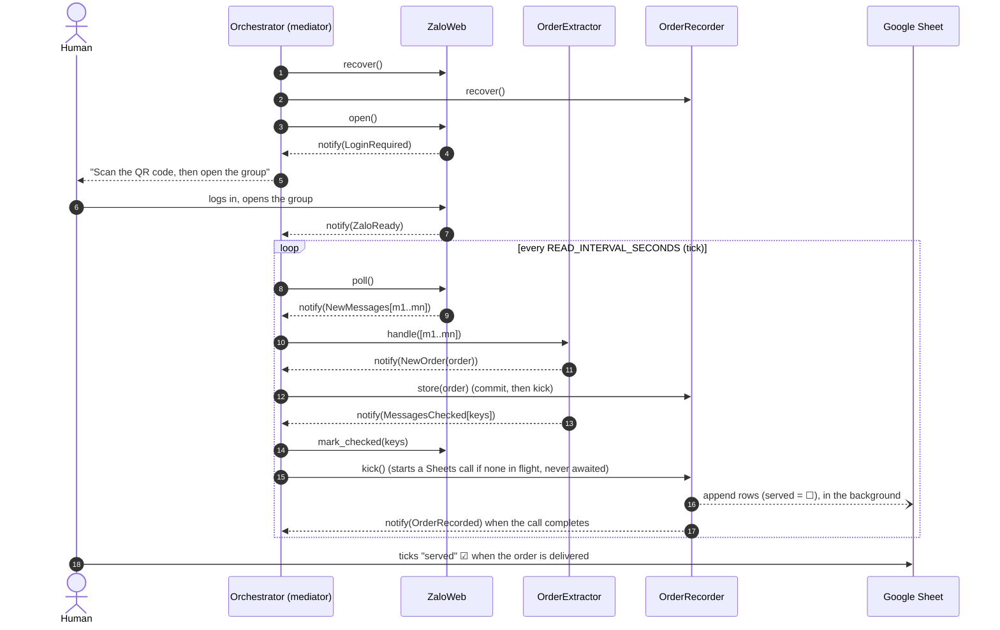
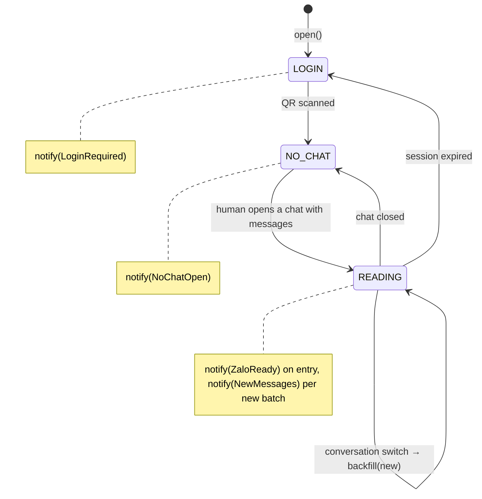
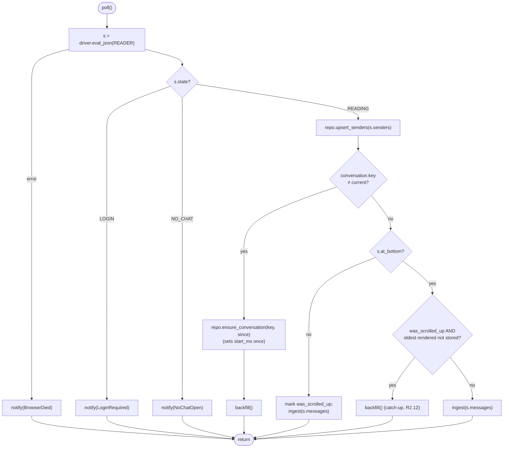
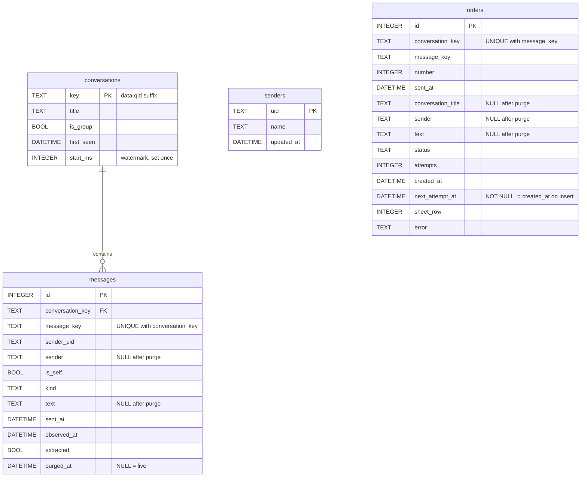
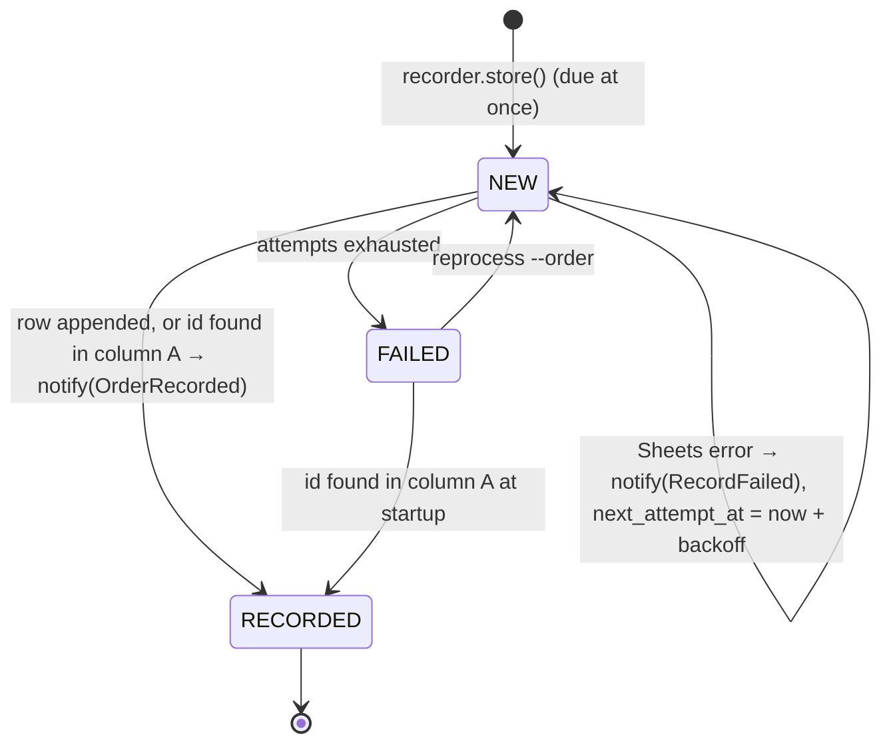

# Design — Zalo Order Extractor

> Phase 2 of 3. Implements [requirements.md](requirements.md) (Rev 5). Requirement IDs in brackets.
> **Rev 3 (2026-11-19):** components talk through a mediator (the Orchestrator). LLM extraction is replaced by a
> pluggable `OrderRule` that returns a single number; the actual rule will be specified later.
> **Rev 4 (2026-11-19):** start watermark, column-A re-check, tick-driven retries, tombstone retention purge.
> **Rev 5 (2026-11-19):** each colleague owns its storage (§1, §7); Sheets calls run off the loop (§6.2); new
> orders are due at once and `FAILED` is reconciled (§6.1); stored senders and catch-up (§4); full event catalogue
> with `recover()` (§1); migrations (§7.2); observability (§8); header check (§6); `reprocess`/`status` (§10).

## 1. Architecture — Mediator pattern

The **Orchestrator** is the mediator. The three colleagues never call each other or touch each other's tables;
each one only knows the mediator and reports what happened through `mediator.notify(event)`. The Orchestrator
decides who handles each event next.

| Colleague | Owns (storage) | Responsibility | Emits |
|---|---|---|---|
| `ZaloWeb` | `conversations`, `messages`, `senders` | Drive `chat.zalo.me`, poll the DOM, store new messages, mark them checked | `LoginRequired`, `NoChatOpen`, `ZaloReady`, `NewMessages`, `SelectorDrift`, `BrowserDied` |
| `OrderExtractor` | nothing (stateless) | Apply `OrderRule` to new messages | `NewOrder`, `MessagesChecked` |
| `OrderRecorder` | `orders` | Store orders, append them to Google Sheets | `OrderRecorded`, `RecordFailed`, `RecorderBlocked` |



### Event flow



### Event catalogue

| Event | Emitted by | Payload | Orchestrator reaction |
|---|---|---|---|
| `LoginRequired` | ZaloWeb | — | Status "Waiting for login…" (once per transition) |
| `NoChatOpen` | ZaloWeb | — | Status "Open a chat to monitor" (once per transition) [R1.3] |
| `ZaloReady` | ZaloWeb | `conversation` | Status line shows the conversation |
| `NewMessages` | ZaloWeb | `list[Message]` (stored, oldest → newest, at/after watermark) | `extractor.handle(messages)` |
| `SelectorDrift` | ZaloWeb | `reason`, `snapshot_path` | Log WARNING "selectors may be outdated"; status flag [R2.9] |
| `BrowserDied` | ZaloWeb | `attempt`, `max_attempts`, `will_retry` | Log ERROR; if `will_retry` is false → stop and exit non-zero [R1.5] |
| `NewOrder` | OrderExtractor | `conversation_key`, `message_key`, `number`, message copy (`sent_at`, `conversation_title`, `sender`, `text`) | `recorder.store(order)` |
| `MessagesChecked` | OrderExtractor | `conversation_key`, `list[message_key]` | `zalo.mark_checked(keys)` |
| `OrderRecorded` | OrderRecorder | `order_id`, `sheet_row` | Update the status line |
| `RecordFailed` | OrderRecorder | `order_ids`, `error`, `next_attempt_at`, `final` | Log (ERROR if `final`); nothing else — retries are tick-driven |
| `RecorderBlocked` | OrderRecorder | `reason` (e.g. header mismatch) | Log ERROR, stop, exit non-zero [R5.3] |

Rules:
- **Persist before notify.** ZaloWeb commits messages before `NewMessages`; OrderRecorder commits an order inside
  `store()`, which runs synchronously before the extractor emits `MessagesChecked`. So a message is marked checked
  only after its order exists [R3.4]. A crash in between re-runs the rule on that message on restart, and `store()`
  is idempotent on `(conversation_key, message_key)`.
- **Recovery is per colleague** [R3.5]: `zalo.recover()` re-emits `NewMessages` for its unchecked messages;
  `recorder.recover()` queues column-A reconciliation (§6.1). The Orchestrator never reads a colleague's tables.
- Events are dispatched synchronously on one asyncio loop, so ordering is preserved and there is no shared-state locking.
  **No handler may block on the network**: the only slow external call (Sheets) runs as a background task (§6.2).
- Each tick: `zalo.poll()`, then `recorder.kick()`, then (once per 24 h) the purges (§7.1).
- Colleagues are tested alone with a fake mediator that records the events it receives.

**Why `playwright-cli` instead of the Python Playwright library:** it is already installed. The browser lives
in its own daemon, so the human can keep using it and the Python process can restart without losing the
login or the open chat. The developer (or a coding agent) uses the same session to inspect the DOM
(`snapshot`, `eval`). Each read is one `--raw eval` subprocess call (about 100–300 ms). The CPU cost of that at a
2 s interval is measured against NFR4 in task T5; if it is too high, the fallback is one long-lived
`playwright-cli` process or a longer interval.

## 2. Tech stack

| Concern | Choice |
|---|---|
| Runtime | Python 3.12 (via `uv`; the system Python 3.15 is too new for some wheels) |
| Browser | `@playwright/cli` (global, ≥ 0.1.14), session `zalo`, `--headed --profile=./data/browser-profile` |
| CLI | `typer`: `start [--since TIME]`, `status`, `reprocess` (§10) |
| DB | SQLite (`sqlite3` stdlib, WAL), one file, one repository module per owning colleague, forward-only migrations (§7.2) |
| Validation | Pydantic v2 (events, `Message`, `NewOrder`) |
| Sheets | `gspread` + service account; HTTP timeout set on the client session |
| Retry | Backoff stored as `orders.next_attempt_at` and driven by the tick (no inline retry library) |
| Logging | stdlib `logging` + a JSON formatter (§8) |
| Tests | `pytest`, `pytest-cov`, saved DOM fixtures (HTML) run through `reader.js` in a headless Playwright |

## 3. Project layout

```
extract-order/
├── pyproject.toml   .env.example   .gitignore (data/, secrets/, .env, .playwright-cli/)
├── selectors.json                # Zalo Web DOM selectors (editable without code changes)
├── src/order_extractor/
│   ├── cli.py                    # typer entrypoint (composition root)
│   ├── config.py
│   ├── telemetry.py              # JSON log formatter, tick_id context
│   ├── events.py                 # Event types (pydantic) + Mediator protocol + Colleague base
│   ├── orchestrator.py           # Orchestrator: the mediator
│   ├── db/
│   │   ├── connection.py         # open SQLite (WAL), run migrations
│   │   └── migrations/0001_init.sql
│   ├── zalo/
│   │   ├── browser.py            # BrowserDriver: wraps playwright-cli subprocess calls
│   │   ├── reader.js             # in-page script: returns page state + messages as JSON
│   │   ├── messages_repo.py      # conversations, messages, senders (owned by ZaloWeb)
│   │   └── zalo_web.py           # ZaloWeb colleague: state machine, backfill, catch-up, ingest
│   ├── extractor/
│   │   ├── order_extractor.py    # OrderExtractor colleague (stateless)
│   │   └── rules.py              # OrderRule protocol + current rule (placeholder)
│   └── recorder/
│       ├── orders_repo.py        # orders (owned by OrderRecorder)
│       ├── sheet.py              # gspread adapter: header, read column A, append_rows
│       └── order_recorder.py     # OrderRecorder colleague
└── tests/
    ├── fixtures/dom/*.html       # sanitized Zalo Web DOM samples (login, no chat, 1-1, group)
    ├── fakes.py                  # FakeMediator, FakeDriver, InMemorySheet
    └── test_*.py
```

## 4. ZaloWeb colleague

### 4.1 Browser driver [R1]

```python
class BrowserDriver:
    def ensure_open(self) -> None:
        # `playwright-cli list --json`; if "zalo" missing →
        # `playwright-cli -s=zalo open https://chat.zalo.me --headed --profile=./data/browser-profile`
    def eval_json(self, js: str) -> Any:
        # `playwright-cli -s=zalo --raw eval <js>` → json.loads(stdout); timeout 10 s
    def snapshot(self, path: Path) -> None:   # for selector-drift diagnostics [R2.9]; path under data/snapshots/
    def scroll_messages(self, dy: int) -> None:  # via eval: container.scrollTop += dy  (only allowed UI action) [R1.4]
```
- The script is built once at startup: `reader.js` with `selectors.json` inlined as a JSON literal, wrapped as
  `() => JSON.stringify(readState(SEL))`, and passed as a **single argv element** via `subprocess.run([...])`
  (no shell, so no shell escaping). T5 verifies the argv length limit is not hit.
- Failure handling [R1.5]: a non-zero exit or "no session" → `ensure_open()` relaunch and `BrowserDied(attempt,
  max, will_retry)`. Consecutive failures count up to `BROWSER_MAX_RESTARTS`; a successful read resets the counter.

### 4.2 In-page reader (`reader.js`) [R1, R2]

Returns a single JSON object:

```json
{
  "state": "LOGIN | NO_CHAT | READING",
  "conversation": {"key": "g1366548983169703056", "title": "Nhóm khách sỉ", "is_group": true},
  "at_bottom": true,
  "senders": {"3808620345438131900": "Lan"},
  "messages": [
    {"message_key": "1794544726909_3808620345438131900", "sent_at_ms": 1794544726909,
     "sender_uid": "3808620345438131900", "sender": "Lan",
     "is_self": false, "kind": "text", "text": "Shop ơi cho em 2 áo thun đen size M"}
  ]
}
```

- `state` is checked in this order [R1.2]: **LOGIN** if the login DOM is present or the title, after stripping an
  unread prefix `^\(\d+\)\s*`, equals `login_title`; else **NO_CHAT** if no message list is present **or** no bubble
  carries a `data-qid` (an empty conversation has no key yet) [R1.3]; else **READING**. T2b checks whether the
  title really gets an unread prefix and, if the title proves unreliable, replaces it with a DOM signal.
- **Conversation key** [R2.13]: the `<convKey>` suffix of the bubbles' `data-qid`. The URL never changes, and the title is
  display-only. If bubbles disagree on the suffix, the reader reports `SelectorDrift`.
- Each bubble's `data-qid` = `<ref>@<sentAtMs>_<senderUid>_<convKey>` gives the exact time, the sender uid
  (`0` = self) and the conversation key. Details are in [notes/zalo-dom.md](notes/zalo-dom.md).
- `senders`: `uid → name` for every rendered bubble that carries `.message-sender-name-content`. `sender` on each
  message is filled from this map when the name is rendered, else left `null` for ZaloWeb to resolve (§4.4) [R2.7].
- Self = uid `0` or `.chat-item.me` [R2.8].
- Kind detection: `message-text-content` present → `text`; `.chatImageMessage--audit` → `[image]`; sticker/file →
  placeholder; any other bubble without text → `[other]` [R2.6].
- **All selectors come from [`selectors.json`](../selectors.json).**

### 4.3 Page state



### 4.4 Poll cycle [R2]



**`ingest(messages)`** is the single insert path used by poll, backfill, and catch-up [R2.10]:

```python
def ingest(self, conv, messages) -> None:
    batch = []
    for m in sorted(messages, key=lambda m: m.sent_at_ms):  # chronological [R2.2]
        if repo.exists(conv.key, m.message_key):
            continue
        m.sender = m.sender or repo.sender_name(m.sender_uid) or m.sender_uid  # stored senders [R2.7]
        checked = m.sent_at_ms < conv.start_ms  # watermark [R2.11]
        repo.insert_message(conv.key, m, extracted=checked)  # commit per message
        if not checked:
            batch.append(m)
    if batch:
        self.mediator.notify(NewMessages(batch))
```

**`backfill()`** [R2.4]: `ingest(current screen)`, then loop { `scroll_messages(-viewport)`; wait 800 ms; re-read;
`ingest(rendered)` } until any of these holds:
1. the **oldest rendered bubble** is already stored (bubbles at the bottom are always stored, so a "any stored key
   appears" test would stop on the first screen);
2. the oldest rendered bubble is older than `conv.start_ms` (older messages could never become orders; they only
   matter for de-duplication, and `ingest` handles them whenever they do render);
3. `BACKFILL_MAX_MESSAGES` messages gathered this run;
4. `scrollTop` stays at 0 for two reads.

Then scroll back to the bottom. After a restart `current` is empty, so the first READING poll backfills too.
That also picks up messages that arrived while the tool was down. Because every screen goes through `ingest`, backfill applies the watermark exactly
like the live poll, and may emit several `NewMessages` events (one per screen), each oldest-first within itself.
Across screens, older screens arrive later. That is acceptable because orders are independent per message (Q-group:
no). If Q-group changes, backfill must buffer and emit once.

**Catch-up** [R2.12]: while `at_bottom` is false, the poll still ingests whatever is rendered (the human may be reading
history) and sets `was_scrolled_up`. When the list is back at the bottom and the oldest rendered bubble is not
stored, a gap may exist below what the human looked at, so `backfill()` runs. When the oldest bubble is already
stored there is no gap and nothing scrolls. A one-time WARNING still says live reading was paused.

**Start watermark** [R2.11]: `ensure_conversation(key, since)` inserts `conversations(key, start_ms)` with
`start_ms = --since` if given, else `now()`, only if the key is new. `--since` applies to every conversation first
seen during the run, including ones the human opens later, which is intended: "check everything since T in any
group I open today". Re-running `start --since` for a conversation already known does nothing; re-checking old
messages is `reprocess` (§10).

**Time**: `sent_at` comes from the epoch ms in `data-qid`. `observed_at` is stored for diagnostics only.
**Scroll container**: `#chatView .transform-gpu`. "At bottom" means `scrollTop + clientHeight ≥ scrollHeight − 5`.

**Selector drift** [R2.9]: READING with 0 parsed messages for `SELECTOR_ALERT_SECONDS`, a reader exception, or
inconsistent conversation keys → `driver.snapshot(data/snapshots/<ts>.yml)` and `notify(SelectorDrift)`, at most
once per `SELECTOR_ALERT_SECONDS`.

**`recover()`**: emits `NewMessages` for `repo.unchecked_messages()` (oldest first, in chunks of 100).
**`mark_checked(keys)`**: `UPDATE messages SET extracted = 1` for those keys.

## 5. OrderExtractor colleague (stateless)

```python
class OrderRule(Protocol):
    def extract(self, message: Message) -> int | None: ...  # the order number, or None if not an order


class OrderExtractor(Colleague):
    def handle(self, messages: list[Message]) -> None:
        for m in messages:  # oldest → newest
            if m.is_self or m.kind != "text":  # shop messages and media never create orders [R4.2]
                continue
            number = self.rule.extract(m)
            if number is not None:
                self.mediator.notify(NewOrder.from_message(m, number))  # recorder stores it synchronously
        self.mediator.notify(MessagesChecked(conv, [m.message_key for m in messages]))  # [R4.4]

    def recover(self) -> None:  # nothing to recover; ZaloWeb re-emits unchecked messages
        pass
```

- **The rule is a placeholder.** The order is a single number; how it is read from the text is still to be
  specified. Until then `rules.py` ships a stub that returns `None` [R4.5]. Tests and the manual E2E use a test rule.
- One message → at most one order. Grouping several messages into one order is out of scope until the rule needs it.

## 6. OrderRecorder colleague — Google Sheet

Tab `SHEET_ORDERS_TAB` (default `Orders`), one row per order:

| Column | Example | Written by |
|---|---|---|
| `order_id` | `42` | app |
| `time` | `2026-11-19 10:38` (`TZ_DISPLAY`) | app |
| `conversation` | `Nhóm khách sỉ` | app |
| `sender` | `Lan` | app |
| `messages` | `Shop ơi cho em 2 áo thun đen size M` | app |
| `order` | `2` | app |
| `served` | ☐ checkbox | **human only** |

- **Header check** [R5.3]: on the first Sheets call, read row 1. Empty → write the header and apply checkbox data
  validation to column G. Equal to the expected header → continue. Anything else → `notify(RecorderBlocked)` and
  write nothing, so a reordered or inserted column never receives the wrong data.
- New rows are appended with `served = FALSE`. The app **never writes the `served` column again**, so a human tick
  is never overwritten.
- `value_input_option="RAW"`: values are stored as typed, so message text starting with `=`, `+`, `-`, or `@` is
  never evaluated as a formula. `order_id` is written as a string.
- **One append path:** all due orders (up to `RECORD_BATCH_MAX`, default 50) go into one `append_rows` call. It
  succeeds or fails as a unit.

`store(order)` inserts the order with `status = NEW`, `attempts = 0`, `next_attempt_at = created_at`
(due at once [R5.1]), ignoring a duplicate `(conversation_key, message_key)`, then commits. It does no I/O beyond SQLite.

### 6.1 Idempotency [R5.5]

Column A is the source of truth for "already written". The recorder keeps `written: set[str]` (trimmed strings;
gspread returns `"42"` for a written `42`) and refreshes it from the sheet at the points where SQLite can be wrong:

| Situation | What SQLite says | Fix |
|---|---|---|
| Crash after `append_rows` returned, before `status = RECORDED` committed | `NEW` | **Startup (`recover()`):** read column A; every `NEW` **or `FAILED`** order already in it → `RECORDED`, no append |
| Append reached Google but the response was lost (timeout, reset, 5xx) | `NEW`, `attempts ≥ 1` | **Before every retry** (any due order has `attempts ≥ 1`): re-read column A; ids found → `RECORDED`, no append |
| Same, on the **last** attempt | `FAILED` | Reconciled on the next startup (row above) or by `reprocess --order` (§10), which also re-reads column A |

A batch of first attempts trusts the cached set, so the normal path costs one API call. Rows that staff delete by
hand are not re-appended for orders already `RECORDED`.

### 6.2 Off-loop Sheets calls and backoff [R5.6, NFR1]

At most one Sheets job is in flight. The tick never awaits it, so a slow or dead Sheets API cannot delay `poll()`,
regardless of how many orders a backfill produced:

```python
def kick(self) -> None:  # called by the Orchestrator every tick and after store()
    if self.job and not self.job.done():
        return  # one call in flight at most
    if not self.ready:  # header check + reconciliation not done yet
        self.job = create_task(self._prepare())  # also backed off on failure
        return
    due = orders_repo.due(now(), limit=RECORD_BATCH_MAX)  # status NEW AND next_attempt_at <= now
    if due:
        self.job = create_task(self._flush(due))


async def _flush(self, due: list[Order]) -> None:
    todo = due  # orders this call carries
    try:
        if any(o.attempts > 0 for o in due):  # §6.1: an earlier attempt may have landed
            self.written = await to_thread(sheet.read_order_ids)
        for o in [o for o in due if str(o.id) in self.written]:
            orders_repo.mark_recorded(o)
            self.mediator.notify(OrderRecorded(o.id, None))
        todo = [o for o in due if str(o.id) not in self.written]
        if todo:
            rows = await to_thread(sheet.append_rows, todo)  # client timeout = SHEETS_TIMEOUT_SECONDS
            for o, row in zip(todo, rows):
                orders_repo.mark_recorded(o, row)
                self.written.add(str(o.id))
                self.mediator.notify(OrderRecorded(o.id, row))
    except SheetsError as e:  # includes the client timeout
        for o in todo:
            n = o.attempts + 1
            if n >= RECORD_MAX_ATTEMPTS:
                orders_repo.mark_failed(o, e)
            else:
                delay = min(BASE * 2 ** (n - 1), MAX) * uniform(0.5, 1.0)  # jittered backoff
                orders_repo.schedule_retry(o, attempts=n, next_attempt_at=now() + delay, error=e)
        self.mediator.notify(RecordFailed(ids, e, next_attempt_at, final=...))
```

- `to_thread` keeps the blocking gspread call off the loop; the coroutine resumes **on the loop**, so all SQLite writes
  and `notify` calls stay on the loop thread (no locking).
- `asyncio` cannot cancel a running thread, so the HTTP timeout is set on gspread's session. A hung call only
  delays the next Sheets job, never `poll()`.
- On shutdown the Orchestrator waits up to `SHEETS_TIMEOUT_SECONDS` for the in-flight job, then exits; anything
  unfinished is reconciled on the next start.
- `FAILED` orders are never retried automatically; see `reprocess --order` (§10).

## 7. Data model (SQLite)

One database file; each table has exactly one owning repository. No foreign key crosses an ownership boundary:
orders reference their message by value and carry their own copy of the fields the sheet needs.



Owners: `conversations`, `messages`, `senders` → `zalo/messages_repo.py`; `orders` → `recorder/orders_repo.py`.

Order state machine:



`served` is not stored in SQLite; the Google Sheet is the source of truth for it.

### 7.1 Retention purge [R6.3]

Each owner purges its own tables, once at startup and then every 24 h from the tick.

```sql
-- messages_repo.purge: tombstones keep UNIQUE(conversation_key, message_key) rejecting re-inserts
UPDATE messages SET text = NULL, sender = NULL, purged_at = :now
WHERE purged_at IS NULL AND sent_at < :cutoff AND extracted = 1;

-- orders_repo.purge: keep content until the row is in the sheet
UPDATE orders SET text = NULL, sender = NULL, conversation_title = NULL
WHERE text IS NOT NULL AND sent_at < :cutoff AND status = 'RECORDED';
```

- An unchecked message keeps its text, because the rule still needs it. A `NEW`/`FAILED` order keeps its copy,
  because the recorder still needs it. Neither depends on the other's table.
- `senders` holds display names only; a name is dropped if its uid has no live message (`purged_at IS NULL`).
- ZaloWeb deletes files in `data/snapshots/` older than the window.
- Tombstones cost about 100 bytes each; at a few thousand messages a day that is well under 1 MB a year, so they are never deleted.

### 7.2 Migrations

Forward-only SQL files in `db/migrations/NNNN_name.sql`, applied at startup in order inside one transaction each,
with `PRAGMA user_version` holding the last applied number. No ad-hoc DDL elsewhere; a test opens an empty DB,
migrates, and compares the schema with the expected one.

## 8. Observability [R6.4, R6.5]

| Output | Where | Content |
|---|---|---|
| Status line | stdout (redrawn) | login state, conversation, read / found / recorded / failed counts, Sheets job state |
| Logs | stderr (WARNING+) and `LOG_DIR/app.jsonl` (INFO+, rotated daily, kept `RETENTION_DAYS`) | one JSON object per line |

- Every log line has `ts`, `level`, `event`, `tick_id` (a new id per tick, held in a `contextvars` var and set as the
  correlation id for everything that tick causes, including the Sheets job it starts), and when relevant
  `conversation_key`, `message_key`, `order_id`, `attempt`.
- Message text, sender names and titles are logged only at DEBUG [R6.1].
- **No OTLP/Prometheus:** this is a single-process local tool with no collector to send to. The `tick_id` is the
  correlation id, and `status` (§10) provides the counts. If the tool is ever deployed as a service, swap the
  formatter for OpenTelemetry logs + traces with the `tick_id` as the root span.

## 9. Configuration (`.env`)

```
ZALO_URL=https://chat.zalo.me
PW_SESSION=zalo
PW_PROFILE_DIR=./data/browser-profile
READ_INTERVAL_SECONDS=2
BACKFILL_MAX_MESSAGES=200
SELECTOR_ALERT_SECONDS=60
BROWSER_MAX_RESTARTS=3
GOOGLE_SERVICE_ACCOUNT_FILE=./secrets/sa.json
SHEET_ID=<your-sheet-id>
SHEET_ORDERS_TAB=Orders
SHEETS_TIMEOUT_SECONDS=10
RECORD_BATCH_MAX=50
RECORD_MAX_ATTEMPTS=5
RECORD_BACKOFF_BASE_SECONDS=2
RECORD_BACKOFF_MAX_SECONDS=300
RETENTION_DAYS=30
DB_PATH=./data/app.db
LOG_DIR=./data/logs
TZ_DISPLAY=Asia/Ho_Chi_Minh
```

## 10. Maintenance commands [R7]

- `status`: counts per order status and the oldest `NEW`/`FAILED` order, read from `orders_repo`. Safe to run any time.
- `reprocess --order <id>`: `FAILED` → `NEW`, `attempts = 0`, `next_attempt_at = now`. The next `start` re-reads
  column A first (reconciliation), so a row that did land is not appended twice.
- `reprocess --conversation <key> --since <time>`: `messages_repo.unmark_checked(key, since)` for live (not purged)
  messages. On the next `start`, `zalo.recover()` re-emits them, the rule runs again, and `store()` ignores
  messages that already have an order.
- Both `reprocess` forms take `data/app.lock` and refuse to run while `start` holds it. `cli.py` is the composition
  root, so it may call each repository directly. It never mixes two repositories in one operation.

## 11. Testing strategy

- **Orchestrator:** fake colleagues; each event in §1 is routed to the right handler; startup calls `recover()` on
  each colleague; `BrowserDied(will_retry=False)` and `RecorderBlocked` stop the loop with a non-zero exit; a recorder
  whose job never completes does not delay the next `poll()`.
- **ZaloWeb:** `reader.js` against sanitized DOM fixtures in headless Chromium (state order with an unread-count
  title, empty conversation → NO_CHAT, conversation key from qid). `zalo_web.py` with `FakeDriver` + `FakeMediator`:
  duplicates across polls; conversation switch; each backfill stop condition, including "oldest rendered stored" not
  firing on the first screen; backfill uses `ingest` (watermark applied); catch-up runs only when there is a gap;
  sender name resolved from the `senders` table when the header has scrolled away; `--since` applies on first sight only.
- **OrderExtractor:** self/media skipped; `MessagesChecked` emitted after any `NewOrder` for the batch; a test rule
  returning a number → one `NewOrder`.
- **OrderRecorder:** `InMemorySheet` with failure injection and a frozen clock. Header empty → created; header
  mismatch → `RecorderBlocked`, nothing written. A fresh order is due at once (`next_attempt_at = created_at`). Crash
  after append → no duplicate after restart. Append lands but raises a timeout → no duplicate on retry. Last attempt
  lands but times out → `FAILED` → `RECORDED` at the next startup. Ids compared as strings. A 50-order burst with
  Sheets down → one in-flight job, `poll()` unaffected. `served` never written after append.
- **Repositories / retention / migrations:** idempotent inserts; watermark set once; tombstones; re-inserting a purged
  key is a no-op; unchecked messages and unrecorded orders keep their content; migrations from empty match the schema.
- **Telemetry:** a tick's log lines share one `tick_id`; message text is absent at INFO.
- **Manual E2E:** live group with a test account; tick `served` in the sheet and confirm the app leaves it alone.

## 12. Open questions

- **Q-rule:** how the order number is extracted from a message (to be provided).
- **Q-group:** whether an order can span several messages from the same sender (affects §5, §4.4 backfill
  ordering, and the `orders` key).
